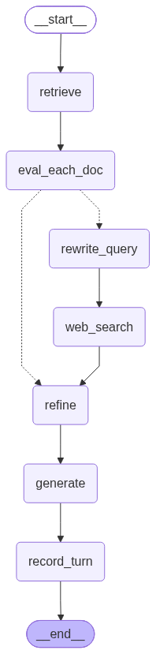

# ✨ Clarity CRAG — Corrective RAG Study Assistant

> A **Corrective RAG (CRAG)** chat app that grades its own retrieval, falls back to **live web search** when it's not confident, and only ever answers from evidence it actually trusts.

---

## 📄 The paper this is built on

Corrective RAG comes from **[Corrective Retrieval Augmented Generation](https://arxiv.org/abs/2401.15884)** (arXiv:2401.15884), submitted January 2024 by Shi-Qi Yan and Zhen-Hua Ling (University of Science and Technology of China), Jia-Chen Gu (UCLA), and Yun Zhu (**Google DeepMind**).

<p align="center"></p>
<p align="center"><sub>Figure from the paper: a lightweight retrieval evaluator scores confidence and routes to one of three knowledge-source strategies — Correct, Incorrect, or Ambiguous.</sub></p>

Standard RAG trusts whatever the retriever returns, even when it's irrelevant. The paper's fix is a lightweight retrieval evaluator (a fine-tuned T5-large in the paper; an LLM judge in this project) that scores each retrieved chunk and decides one of three actions:

- **Correct** — the internal documents are good enough, refine and use them as-is.
- **Incorrect** — discard them and fall back to a web search instead.
- **Ambiguous** — blend refined internal documents with web search results.

Either way, the surviving text is decomposed into small "strips," each strip is filtered for relevance, and only the strips that pass are recomposed into the context the LLM finally answers from — the paper calls this **decompose-then-recompose** knowledge refinement.

For a deeper walkthrough of the paper, see Sulbha Jain's review: [Corrective Retrieval Augmented Generation (CRAG) — Paper Review](https://sulbhajain.medium.com/corrective-retrieval-augmented-generation-crag-paper-review-2bf9fe0f3b31).

This repo is a from-scratch, production implementation of that idea (FastAPI + LangGraph + Pinecone) — not the paper's official code.

---

Built on top of an iterative six-notebook research process, then productionized into a FastAPI backend + React chat UI, with Pinecone for vectors, SQLite-backed per-thread memory, LangSmith tracing, and a golden-dataset evaluation harness proving CRAG beats naive RAG.

---

## 📚 Table of contents

- [✨ Clarity CRAG — Corrective RAG Study Assistant](#-clarity-crag--corrective-rag-study-assistant)
  - [📄 The paper this is built on](#-the-paper-this-is-built-on)
  - [📚 Table of contents](#-table-of-contents)
  - [🧠 What is CRAG, and why does it matter?](#-what-is-crag-and-why-does-it-matter)
  - [Dashboard](#dashboard)
  - [🏗️ Architecture](#️-architecture)
  - [🕸️ The graph](#️-the-graph)
  - [📂 Project structure](#-project-structure)
  - [🧰 Tech stack](#-tech-stack)
  - [🚀 Getting started](#-getting-started)
    - [1. Backend](#1-backend)
    - [2. Frontend](#2-frontend)
  - [🔭 LangSmith observability](#-langsmith-observability)
  - [🧪 Evaluation: CRAG vs naive RAG](#-evaluation-crag-vs-naive-rag)
  - [📓 The notebook evolution (1 → 6)](#-the-notebook-evolution-1--6)
  - [🗺️ API reference](#️-api-reference)
  - [🎨 Frontend tour](#-frontend-tour)
  - [🩹 Troubleshooting](#-troubleshooting)

---

## 🧠 What is CRAG, and why does it matter?

Plain RAG has a blind spot: it retrieves top-*k* chunks and trusts them unconditionally, even when they're irrelevant or only partially useful. **Corrective RAG (CRAG)** adds a correction loop on top of retrieval:

1. 🔍 **Retrieve** candidate chunks from the vector store.
2. 🧑‍⚖️ **Grade every chunk** with an LLM judge that scores relevance from `0.0` → `1.0`.
3. 🚦 **Decide a verdict**:
   - ✅ **CORRECT** — at least one chunk scored above the upper threshold → trust internal docs.
   - 🚫 **INCORRECT** — every chunk scored below the lower threshold → discard them, search the web instead.
   - 🤔 **AMBIGUOUS** — mixed signal → use internal docs **and** web search together.
4. ✂️ **Refine**: decompose the surviving context into sentences ("strips") and run each one through an LLM filter, keeping only sentences that actually help answer the question.
5. 🌐 **Web fallback**: for INCORRECT/AMBIGUOUS, the question is rewritten into a keyword search query and sent to Tavily before refining.
6. 💬 **Generate** the final answer strictly from the refined, filtered context — never from raw retrieval.

The payoff: fewer hallucinations, graceful degradation when the knowledge base doesn't cover a question, and a transparent verdict you can show the user (see the badges in the chat UI 👇).

---
## Dashboard 

<p align="center"></p>

---
## 🏗️ Architecture

```
┌─────────────────┐      HTTP/JSON       ┌───────────────────────┐
│   React + Tailwind│ ───────────────────▶ │   FastAPI backend     │
│   chat UI (Vite)  │ ◀─────────────────── │   (backend/app)       │
└─────────────────┘                       └───────────┬───────────┘
                                                        │
                              ┌─────────────────────────┼─────────────────────────┐
                              ▼                         ▼                         ▼
                    ┌──────────────────┐     ┌────────────────────┐    ┌───────────────────┐
                    │  Pinecone (vectors)│     │ SqliteSaver         │    │ LangSmith          │
                    │  gemini-embedding- │     │ (per-thread short-  │    │ (trace every node, │
                    │  001, 512-dim       │     │ term memory)        │    │  every LLM call)   │
                    └──────────────────┘     └────────────────────┘    └───────────────────┘
                              ▲
                              │
                    ┌──────────────────┐
                    │  Tavily web search │  (used only when the CRAG verdict says so)
                    └──────────────────┘
```

**Modularity:** the entire pipeline from notebook 6 was split into a real package —
`backend/app/crag/{state,prompts,nodes,vectorstore,graph}.py` — instead of one linear notebook.
Nothing about the *logic* changed (same 0.7 / 0.3 thresholds, same sentence-level filter, same
routing rules) — only the vector store (FAISS → Pinecone) and the addition of persistent,
per-thread memory did.

**Memory:** a `history` field on the graph state accumulates `{role, content, verdict,
used_web_search}` turns via LangGraph's reducer pattern (`Annotated[List[dict], operator.add]`).
A `SqliteSaver` checkpointer persists the whole graph state per `thread_id`, so re-invoking the
graph for the same thread automatically continues from where it left off — that *is* the
short-term memory, no separate chat-log table needed.

---

## 🕸️ The graph

Generated straight from `graph.get_graph().draw_mermaid_png()` — see
[`backend/scripts/save_graph_image.py`](backend/scripts/save_graph_image.py).



---

## 📂 Project structure

```
Clarity CRAG/
├── iterative_notebooks/        # 1_basic_rag → 6_ambiguous, unchanged, kept for history
├── documents/                  # source PDFs that get embedded into Pinecone
├── assets/graph.png            # saved LangGraph diagram
├── backend/
│   ├── app/
│   │   ├── main.py             # FastAPI app + endpoints
│   │   ├── config.py           # env-driven Settings
│   │   ├── db.py               # sqlite thread-metadata store (title/timestamps)
│   │   ├── schemas.py          # Pydantic request/response models
│   │   └── crag/
│   │       ├── state.py        # LangGraph State (+ history reducer)
│   │       ├── prompts.py      # every prompt, ported 1:1 from notebook 6
│   │       ├── nodes.py        # retrieve/grade/refine/rewrite/web_search/generate/record_turn
│   │       ├── vectorstore.py  # Pinecone index + retriever
│   │       └── graph.py        # builds + compiles the StateGraph with SqliteSaver
│   ├── scripts/
│   │   ├── ingest.py           # embeds documents/*.pdf into Pinecone
│   │   └── save_graph_image.py # writes assets/graph.png
│   ├── data/                   # sqlite files, created at runtime (gitignored)
│   ├── requirements.txt
│   └── .env.example
├── frontend/                   # Vite + React + Tailwind v4, single-page chat UI
│   └── src/
│       ├── App.jsx
│       ├── components/{Sidebar,ChatWindow,MessageBubble,VerdictBadge,EmptyState}.jsx
│       └── lib/api.js
└── evaluation/
    ├── golden_dataset.json     # 13 ML/DL questions + reference answers
    ├── run_eval.py             # Naive RAG vs CRAG, scored with ragas
    └── results/                # generated: tables + chart (see below)
```

---

## 🧰 Tech stack

| Layer            | Choice                                             |
|-------------------|-----------------------------------------------------|
| LLM (chat)        | Google Gemini (`gemini-3.5-flash-lite` / `gemini-1.5-flash`) primary, falling through to Groq (`llama-3.1-8b-instant`), with single-call batch refinement to stay within free-tier rate limits |
| Embeddings        | Gemini `gemini-embedding-001` (512-dim, free tier), fallback local `jinaai/jina-embeddings-v2-small-en` (FastEmbed/ONNX) |
| Orchestration     | LangGraph `StateGraph`                              |
| Vector store      | Pinecone (serverless)                               |
| Short-term memory | LangGraph `SqliteSaver` (per `thread_id`)            |
| Web fallback      | Tavily search                                        |
| Observability     | LangSmith                                            |
| Backend           | FastAPI + Uvicorn                                    |
| Frontend          | React 19 + Vite + Tailwind CSS v4                    |
| Evaluation        | [ragas](https://github.com/explodinggradients/ragas) |

---

## 🚀 Getting started

### 1. Backend

```bash
cd backend
python -m venv ../.venv && source ../.venv/bin/activate
pip install -r requirements.txt

cp .env.example .env
# now edit .env and fill in: HF_TOKEN, GEMINI_API_KEY, GROQ_API_KEY, PINECONE_API_KEY, TAVILY_API_KEY
# (LANGCHAIN_* keys are optional but recommended - see Observability below)

# one-time: embed documents/*.pdf into Pinecone
python scripts/ingest.py

# generate/refresh the graph diagram (no keys needed)
python scripts/save_graph_image.py

# run the API
uvicorn app.main:app --reload --port 8000
```

The API is now live at `http://localhost:8000` (docs at `/docs`).

### 2. Frontend

```bash
cd frontend
npm install
npm run dev
```

Open `http://localhost:5173` — the Vite dev server proxies `/api` to `localhost:8000`
(see `frontend/vite.config.js`), so no CORS setup is needed in dev.

---

## 🔭 LangSmith observability

Tracing is entirely env-var driven — no code changes needed. In `backend/.env`:

```bash
LANGCHAIN_TRACING_V2=true
LANGCHAIN_API_KEY=lsv2_...
LANGCHAIN_PROJECT=Clarity CRAG
```

Once set, every node (`retrieve`, `eval_each_doc`, `refine`, `rewrite_query`, `web_search`,
`generate`) and every underlying LLM call shows up as a trace in your LangSmith project —
useful for debugging *why* a particular question got an AMBIGUOUS verdict or which sentences
got filtered out during refinement.

---

## 🧪 Evaluation: CRAG vs naive RAG

`evaluation/run_eval.py` answers the same 13 ML/DL golden questions (`evaluation/golden_dataset.json`)
two ways and scores both with [ragas](https://github.com/explodinggradients/ragas):

- **Naive RAG** — raw top-*k* retrieved chunks piped straight into the LLM. No grading,
  no filtering, no web fallback.
- **Corrective RAG (CRAG)** — the exact same graph the API serves: grade → refine → (web
  fallback if needed) → generate.

Metrics: **Faithfulness**, **Answer Relevancy**, **Context Precision**, **Context Recall**, and
**Accuracy** (ragas `answer_correctness`, semantic + factual similarity to the reference answer).

```bash
# from repo root, with backend/.env filled in and the Pinecone index already populated
source .venv/bin/activate
python evaluation/run_eval.py
```

This writes to `evaluation/results/`:
- `comparison_table.md` / `.csv` — side-by-side averages + % improvement
- `per_question_naive.csv` / `per_question_crag.csv` — full per-question ragas scores
- `metrics_chart.png` — grouped bar chart, Naive RAG vs CRAG

<!-- RESULTS_TABLE_START -->
> 📊 **Run `python evaluation/run_eval.py` to populate this section with real numbers** —
> it needs live `HF_TOKEN`/`GEMINI_API_KEY`/`GROQ_API_KEY`/`PINECONE_API_KEY`/`TAVILY_API_KEY` in
> `backend/.env` and a populated Pinecone index, so no numbers are hard-coded here yet.
<!-- RESULTS_TABLE_END -->

---

## 📓 The notebook evolution (1 → 6)

`iterative_notebooks/` preserves the exact research trail, unmodified:

| # | Notebook | What it adds |
|---|----------|---------------|
| 1 | `1_basic_rag.ipynb` | Plain RAG: FAISS retrieval → generate. No correction. |
| 2 | `2_retrieval_refinement.ipynb` | Adds sentence-level decomposition + LLM filter before generation. |
| 3 | `3_retrieval_evaluator.ipynb` | Adds the per-chunk LLM relevance grader (the "C" in CRAG). |
| 4 | `4_web_search_refinement.ipynb` | Adds Tavily web search as a fallback knowledge source. |
| 5 | `5_query_rewrite.ipynb` | Adds LLM query rewriting before web search for better hit rate. |
| 6 | `6_ambiguous.ipynb` | Adds the three-way CORRECT/INCORRECT/AMBIGUOUS verdict + routing — the final pipeline this whole project is built on. |

---

## 🗺️ API reference

| Method | Path                              | Description                                             |
|--------|------------------------------------|-----------------------------------------------------------|
| GET    | `/api/health`                      | Liveness check                                             |
| POST   | `/api/threads`                     | Create a new chat thread                                   |
| GET    | `/api/threads`                     | List all threads (title + timestamps), newest first        |
| GET    | `/api/threads/{thread_id}`         | Get a thread's full message history (from the checkpointer)|
| POST   | `/api/threads/{thread_id}/messages`| Send a message, get back `{answer, verdict, reason, web_query, used_web_search}` |

---

## 🎨 Frontend tour

A single chat page, dark themed, indigo→violet accent:

- **Sidebar** — `+ New Chat` button up top, then every past thread as a clickable button
  (title = first message, relative timestamp), highlighting whichever is active.
- **Chat window** — user bubbles right-aligned in gradient, assistant bubbles left-aligned,
  each assistant reply carries a **verdict badge** (✅ Correct / 🤔 Ambiguous / 🚫 Incorrect)
  and a 🌐 badge when web search was used — so you can see the CRAG pipeline's decision inline.
- **Empty state** — before picking a thread, a welcome screen with example questions you can
  click to start chatting immediately.

---

## 🩹 Troubleshooting

- **"Invalid API key" from Pinecone/HuggingFace/Gemini/Groq** — fill in `backend/.env` (copy
  from `backend/.env.example`) and restart `uvicorn`.
- **Frontend can't reach the API** — make sure `uvicorn` is running on port 8000; the dev
  server proxy in `vite.config.js` targets `http://localhost:8000`.
- **`ingest.py` says no PDFs found** — drop your source PDFs into `documents/`.
- **Pinecone index dimension mismatch** — the index is created with `dimension=512` to match
  `gemini-embedding-001` (truncated via Matryoshka Representation Learning) and the
  `jina-embeddings-v2-small-en` fallback; if you change `EMBEDDING_MODEL`/`EMBEDDING_DIMENSION`,
  delete and recreate the Pinecone index, then re-run `ingest.py`.
- **A chat request is slow / an HF model errors out** — the chat LLM chain has five tiers:
  `HF_CHAT_MODELS` (tried in order) → Gemini → Groq. Open-weight models occasionally emit a
  malformed structured-output call (e.g. a string instead of a boolean); that tier gets one
  quick retry before the chain moves to the next model. A single request grades every
  retrieved doc and filters every context sentence, so it can make many LLM calls — expect
  extra latency (not failure) if several tiers have to be tried in the same request.
- **Gemini free-tier rate limit** — Gemini sits after the HF loop and before Groq in the chat
  chain, and is also the sole embeddings primary (with a local `jina-embeddings-v2-small-en`
  fallback); its free tier caps out around 20 requests/day, so heavy testing can exhaust it -
  the app keeps working via the other tiers, just slower.
